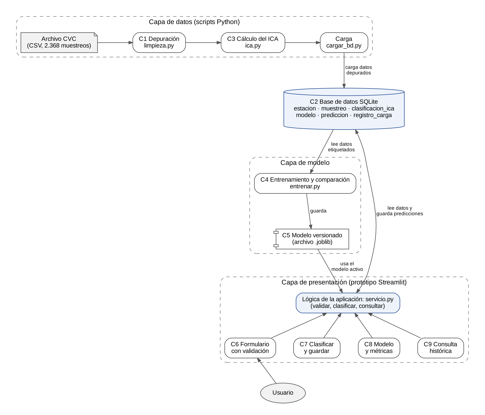
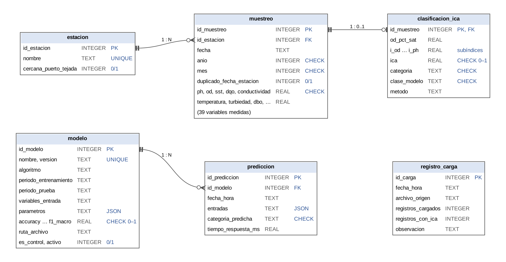
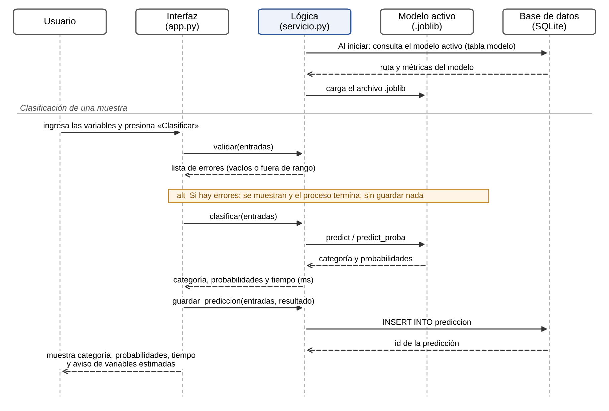

# Paquete de diseño del sistema

Objetivo específico 2 (OE2) · Segundo corte, actualizado en el tercero.
El sistema clasifica la calidad del agua del río Cauca en tres clases (Bueno/Aceptable, Regular, Malo) a partir de variables que **no** forman parte del ICA.

## 1. Arquitectura



El sistema tiene tres capas que comparten una base de datos SQLite:

| Capa | Componentes | Responsabilidad | Requisitos |
|---|---|---|---|
| Datos | C1 limpieza.py · C3 ica.py · cargar_bd.py | Depurar el archivo de la CVC, calcular el ICA y cargar la base | RF-01, RF-02, RF-03, RNF-03 |
| Modelo | C4 entrenar.py · C5 modelos .joblib | Entrenar, comparar y versionar los modelos | OE3, RNF-02, RNF-04 |
| Presentación | servicio.py · C6 a C9 en app.py | Validar, clasificar, mostrar métricas y consultar el histórico | RF-04 a RF-07 |
| Persistencia | C2 base de datos SQLite | Guardar datos, clasificación ICA, modelos y predicciones | RF-02 |

**Decisiones de arquitectura:** la lógica del prototipo (`servicio.py`) está separada de las pantallas para poder probarla con pytest (DEC-14). Los datos entran una sola vez por la capa de datos; el entrenamiento y el prototipo solo leen de la base, y el prototipo solo escribe en la tabla `prediccion`.

## 2. Modelo de datos (entidad-relación)



- Una **estación** tiene muchos **muestreos** (1 : N).
- Un **muestreo** tiene a lo sumo una **clasificación ICA** (1 : 0..1): los 185 muestreos sin las cinco variables del ICA no tienen clasificación.
- Un **modelo** hace muchas **predicciones** (1 : N).
- `registro_carga` es independiente y guarda la trazabilidad de cada carga.

El detalle de cada campo está en [`../diccionario_datos.md`](../diccionario_datos.md).

## 3. Interacción: clasificación de una muestra



Al iniciar, la aplicación consulta en la base cuál es el modelo activo y carga su archivo. Al clasificar, primero valida las entradas; si hay errores, los muestra y no guarda nada. Si son válidas, el modelo devuelve la categoría y las probabilidades, y la predicción se guarda en la base con su tiempo de respuesta.

## 4. Interfaces

El prototipo tiene tres pantallas. Las capturas están en `docs/capturas/` y en el documento de pruebas.

| Pantalla | Qué muestra | Requisito | Evidencia |
|---|---|---|---|
| Clasificar | Formulario (4 variables obligatorias y 10 opcionales), resultado con colores, probabilidades y tiempo | RF-04, RF-05 | PS-01 a PS-08 |
| Modelo y métricas | Modelo activo, comparación de modelos, matriz de confusión, importancia de variables y limitaciones | RF-06 | PS-09 |
| Consulta histórica | ICA en el tiempo por estación y años | RF-07 | PS-10 |

## 5. Seguridad

Datos públicos sin información personal; validación de entradas antes de escribir; restricciones CHECK y llaves foráneas en la base; consultas parametrizadas; la base no se publica en el repositorio. Ver la sección «Seguridad y permisos» del diccionario de datos.

## Cómo regenerar los diagramas

```
dot -Tpng -Gdpi=200 arquitectura.dot -o Figura_arquitectura.png
dot -Tpng -Gdpi=200 er.dot -o Figura_modelo_ER.png
```
