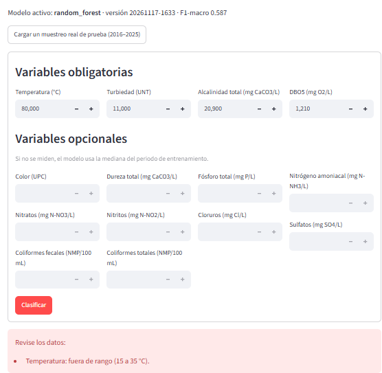
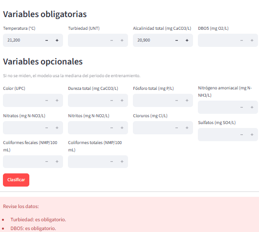
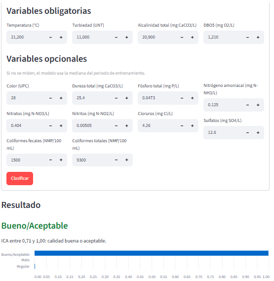
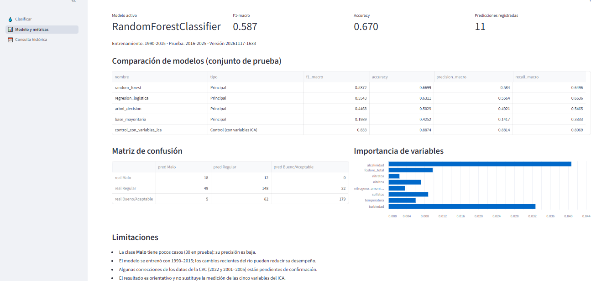
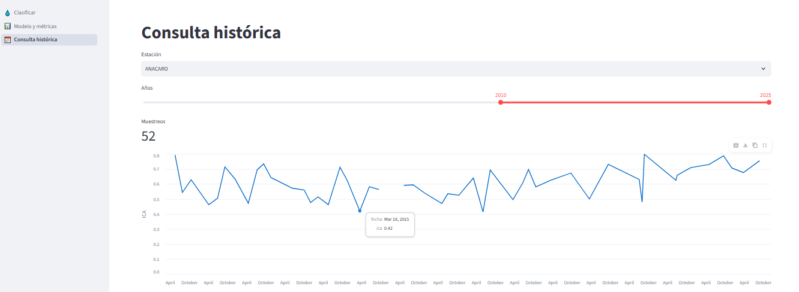

# Manual de usuario

**Sistema:** Prototipo de clasificación de la calidad del agua del río Cauca
**Dirigido a:** técnicos y profesionales del monitoreo ambiental
**Versión del documento:** 1.0 (26 de noviembre de 2026)

> **Importante.** Esta es una herramienta de **apoyo**. Estima la categoría de calidad del agua (según el ICA del IDEAM) a partir de variables que **no** forman parte del índice. No reemplaza el análisis de laboratorio ni el ICA oficial. Toda clasificación **Malo** debe confirmarse con laboratorio.

---

## 1. Qué hace el sistema

Con los valores medidos en una muestra de agua, el sistema indica si su calidad probablemente es:

| Categoría | Significado (ICA) | Color |
|---|---|---|
| **Bueno/Aceptable** | ICA entre 0,71 y 1,00 | Verde |
| **Regular** | ICA entre 0,51 y 0,70 | Naranja |
| **Malo** | ICA entre 0,00 y 0,50 | Rojo |

Además, permite ver qué tan confiable es el modelo y consultar el histórico de las 19 estaciones de la CVC.

## 2. Abrir el sistema

El administrador instala el sistema (ver `manual_tecnico.md`). Para abrirlo:

1. Abra el **cmd** en la carpeta del proyecto.
2. Escriba `py -m streamlit run app\app.py` y presione Enter.
3. Se abre el navegador con el sistema. Si no se abre solo, entre a `http://localhost:8501`.

El menú de la izquierda tiene tres páginas: **Clasificar**, **Modelo y métricas** y **Consulta histórica**.

## 3. Clasificar una muestra

1. En la parte superior verá el **modelo activo**, su versión y su F1-macro.
2. Escriba las **cuatro variables obligatorias**: temperatura (°C), turbiedad (UNT), alcalinidad total (mg CaCO3/L) y DBO5 (mg O2/L).
3. Si las tiene, escriba las **variables opcionales**: color, dureza total, fósforo total, nitrógeno amoniacal, nitratos, nitritos, cloruros, sulfatos y coliformes fecales y totales. Si no las midió, déjelas vacías: el sistema las estima con la mediana histórica.
4. Use **punto** como separador decimal (ejemplo: `21.5`).
5. Pulse **Clasificar**.

**Si hay un error**, el sistema muestra en rojo qué variable debe corregir y no clasifica la muestra:

| Mensaje | Qué hacer |
|---|---|
| `Temperatura: es obligatorio.` | Escriba el valor de la variable |
| `Temperatura: fuera de rango (15 a 35 °C).` | Revise el valor y la unidad; puede ser un error de digitación |

Rangos aceptados: temperatura de 15 a 35 °C; turbiedad de 0 a 5.000 UNT; alcalinidad, DBO5, dureza, cloruros y sulfatos de 0 a 500 mg/L; color de 0 a 3.000 UPC; fósforo total de 0 a 20 mg/L; nitrógeno amoniacal y nitratos de 0 a 50 mg/L; nitritos de 0 a 5 mg/L.

## 4. Interpretar el resultado

- **Categoría:** aparece en color, con su significado.
- **Gráfico de barras:** probabilidad de cada categoría. Si dos categorías tienen probabilidades parecidas, el resultado es menos seguro.
- **Tiempo de respuesta y número de predicción:** la clasificación queda guardada en la base de datos.
- **Aviso amarillo:** lista las variables que el sistema estimó con la mediana. Cuantas más variables estimadas, menos confiable es el resultado.

**Recomendaciones de uso**
- El modelo tiende a dar **falsas alarmas** de la categoría Malo: en las pruebas, la mayoría de las muestras clasificadas como Malo eran en realidad Regulares. Confirme siempre ese resultado con laboratorio.
- En las pruebas, ninguna muestra de calidad Mala fue clasificada como Bueno/Aceptable.

## 5. Probar con un muestreo real

Pulse **Cargar un muestreo real de prueba (2016–2025)**. El sistema llena el formulario con un muestreo real de la CVC y muestra su estación, su fecha y su categoría real según el ICA. Luego pulse **Clasificar** y compare el resultado con la categoría real. Sirve para conocer el sistema o para mostrarlo.

## 6. Ver el modelo y sus métricas

Esta página muestra:
- El modelo activo, su F1-macro, su exactitud y el número de predicciones registradas.
- Los periodos de entrenamiento (1990–2015) y de prueba (2016–2025).
- La comparación de todos los modelos entrenados.
- La matriz de confusión: cuántas muestras de cada categoría se clasificaron bien o mal.
- Las variables que más influyen en el resultado.
- Las **limitaciones** del modelo. Léalas antes de usar los resultados.

## 7. Consultar el histórico de una estación

1. Elija la **estación** en la lista.
2. Mueva el control **Años** para elegir el periodo.
3. El sistema muestra el número de muestreos, un gráfico del ICA en el tiempo y la tabla con los datos.

Sirve para comparar una muestra nueva con el comportamiento histórico de la estación más cercana.

## 8. Preguntas frecuentes

| Pregunta | Respuesta |
|---|---|
| ¿Puedo usar el resultado como el ICA oficial? | No. Es una estimación de apoyo; el ICA oficial requiere medir oxígeno disuelto, SST, DQO, conductividad y pH. |
| ¿Por qué no pide oxígeno disuelto ni pH? | Porque con esas variables se calcula el ICA; si se conocen, conviene calcular el ICA directamente. |
| La página dice que no hay modelo activo | Avise al administrador: debe ejecutar el entrenamiento. |
| ¿Se guardan mis datos? | Solo los valores fisicoquímicos de la muestra y el resultado. El sistema no guarda datos personales. |

*Las imágenes son ilustrativas: se tomaron con una versión anterior del modelo activo; las pantallas y los pasos son los mismos.*
